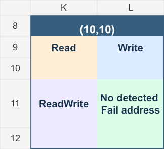

# ASC Wafer Fail Address

使用 Excel VBA 從 `.asc` Raw data 讀取指定測試項目（TNO）的 SRAM Fail Address，並保留 128-chip wafer map 與四象限計數範本。

## 快速開始

1. [下載內嵌 VBA 的 ASC_Fail_Address.xlsm](https://github.com/QooLien/asc-wafer-fail-address/raw/refs/heads/main/templates/ASC_Fail_Address.xlsm)，使用 Windows 電腦版 Excel 開啟。
2. 依公司政策允許該檔案的巨集執行；**不需要匯入 `.bas`，也不需要執行 `.bat`**。
3. 在 `Config!A2:A901` 每列輸入一個 100–999 的整數 TNO，預設為 100。
4. 在 Config 分頁按 **「選擇 ASC 並匯入」**，選擇一個 `.asc` 檔案。也保留 Alt+F8 執行 `ImportASCFailAddresses` 的方式。

`src/ImportFailAddresses.bas` 保留供版本管理與檢閱。舊版 `.xlsx` 是沒有巨集的原始範本；日常使用請開啟新的 `.xlsm`。

VBA 必須在 Windows 電腦版 Excel 執行。iPad 可遠端操作該電腦或查看輸出；iPad 版 Excel 不執行 VBA。

**Excel 2016 請下載 v0.4.1 或更新版本。** v0.4.0 及較早的 `.xlsm` 有封裝內容類型與 OPC 命名空間問題，可能顯示「檔案格式或副檔名無效」。v0.4.1 已修正，並通過 Microsoft Open XML SDK 的 Office2016 格式驗證（0 錯誤）；尚未在 Excel 2016 實機開啟或執行測試。

## ASC 格式與輸出

v0.5.0 統一所有分頁的儲存格文字為 **Calibri、水平置中及垂直置中**。Fail Addresses 標題及資料列均固定 **26 pt** 列高，匯入新資料後維持一致。Config 的匯入按鈕使用 Excel 原生 Forms 控制項，已直接連結內嵌 VBA，不需手動指定巨集。按鈕需在 Windows 桌面版 Excel 允許巨集後操作。

```text
tno= 100 dbk= 1 > [2, 100, 10, 14, 0, 25, 3, 4,]
```

方括號欄位依序為：第一欄、TNO、X、Y、BLK、WL、BL、IO。`dbk` 與第一欄不參與地址判定；TNO 必須與目前 `tno=` 區段一致。以逗號為欄位分界，讀取各欄逗號前的完整整數；接受最後的逗號、一般空格、Tab、換行、不換行空格、全形空白、同一行多組地址及跨行方括號。小數及數字中間的空格不會被強行拼接成地址。

| 欄位 | 有效範圍 |
|---|---|
| TNO | 100–999，由 Config 指定 |
| X、Y | 原始整數座標，本版不依 wafer 外形篩除 |
| BLK | 0–255 |
| WL | 0–1023 |
| BL | 0–15 |
| IO | 0–15 |

超出範圍、缺欄及非整數記錄略過。原需求中的 WLK 按 WL 解讀。

`Fail Addresses` 分頁 A1:F1 固定為 **X / Y / BLK / WL / BL / IO**。G1 起是指定的 TNO，按 Config 首次出現順序排列。同一組六欄地址只輸出一列；該 TNO 有有效 Fail 記錄填 **1**，其餘留白。重複 Fail 不累加，重複 TNO 不重複建欄。

空白表示輸入檔中未找到對應的有效 Fail 記錄，不能據此推論已測試或 Pass。每次匯入取代舊結果；取消檔案選擇、輸入驗證失敗、沒有指定的 TNO 區段及全部地址無效時保留舊結果。錯誤對話框保留原始錯誤代碼及原因；全部地址無效時附第一筆遭略過的記錄。

## Import Log

匯入失敗或資料被略過時，請查看 Excel 的 **Import Log** 分頁。每次執行以 Run ID 區分，追加歷史紀錄，不清除前次 log。關閉 Excel 前請儲存活頁簿，以保留這些紀錄。

| 欄位 | 內容 |
|---|---|
| Timestamp / Run ID | 時間與此次執行識別碼 |
| Level | INFO：開始、取消與完成摘要；WARN：略過地址；ERROR：匯入失敗 |
| Stage | Config 驗證、讀檔、解析、建立或寫入結果等階段 |
| ASC File / TNO | 來源檔案與當前 TNO |
| Source Line | 原始 ASC 的行號；跨行地址記錄起始行，非來源檔錯誤使用 0 |
| Error Code | VBA 錯誤代碼；資料略過使用 0 |
| Reason | 欄位缺漏、非整數、TNO 不符或範圍錯誤；範圍錯誤包含實際值與允許範圍 |
| Raw Record | 有問題的原始記錄（Excel 儲存格上限為 32,767 字元） |

例如 `WL=1024; allowed 0-1023.` 可直接定位超範圍欄位。只記錄指定 TNO 區段中的資料略過問題，未選取的測試項目不逐筆記 WARN。

這份 log 是匯入與資料格式的診斷紀錄；原始 ASC 未提供電性失效原因，因此不推測 SRAM 的物理失效機制。若 log 寫入失敗（例如活頁簿唯讀、工作表受保護或 log 列數已滿），錯誤對話框會另外顯示 log 無法保存的原因。

## 128-chip wafer 參考

| Y | X 範圍 | 每列 chips |
|---|---|---|
| 10–11 | 10–13 | 4 |
| 12–13 | 8–15 | 8 |
| 14–21 | 7–16 | 10 |
| 22–23 | 8–15 | 8 |
| 24–25 | 10–13 | 4 |

共 128 chips；X 向右增加，Y 向下增加。完整座標見 `docs/coordinates.json`。

| 左上：第二象限 | 右上：第一象限 |
|---|---|
| Read | Write |
| **左下：第三象限 ReadWrite** | **右下：第四象限 No detected Fail address** |

四格皆記錄 address count。空白表示未記錄，0 表示實際零值。四象限表位於 `templates/wafer128_SRAM_quadrants.xlsx`；目前尚未定義各 TNO 對應哪一分類，ASC 匯入不會自動回填 wafer map。



[查看完整 wafer map](docs/wafer128_quadrants.png)

## 大型 ASC 與記憶體

v0.4.0 針對約 265,646 KB（259 MB）的 ASC 改為 64 KB 二進位分段讀取。不再使用整檔 `ReadAll` / `LoadFromFile`，正規表示式僅處理目前的小緩衝區。跨段的 TNO、方括號地址、UTF-8 多位元組字元及 CRLF 換行會保留到下一段處理。

去重索引只儲存「六欄地址 → Excel 列號」，不再為每個地址建立另一個 TNO 字典。匯入先寫入暫存工作表，成功解析後每批最多 1,000 列移至正式輸出；Log 累積到 500 筆時分批寫入。暫存工作表在成功或錯誤結束時移除；解析失敗時保留上一次正式結果。

讀檔字串不再隨檔案大小成長，但唯一地址索引與 Excel 結果本身仍會佔用記憶體。單一檔案必須小於 2 GB；唯一地址最多 1,048,575 列。未閉合方括號累積超過 16,384 字元會記錄 WARN 並略過，避免格式損壞造成字串無限累積。

## 狀態與限制

- 第四版內嵌 VBA、Import Log 及分段讀檔，依使用者提供的格式建立，尚未取得實際 ASC 樣本。
- 使用 Windows VBScript 引擎執行從 VBA 原始碼轉換的解析函式：20 種地址案例、每段 1 / 7 / 65,536 字元的跨段測試、EOF 與過長未閉合記錄測試均通過，並檢查去重、TNO 標記與 Log 行號及原因。
- 以 272,021,735 bytes 的合成檔進行分段解析測試，保留的未解析緩衝區最高 128 字元。此檔主要由無地址的填充內容及少量有效/錯誤案例構成，用於驗證檔案大小不造成整檔字串堆積，不代表大量唯一地址的 Excel 寫入效能或記憶體壓力測試。
- VBA 容器已經獨立的 `olevba` 讀回，核對內嵌原始碼與 `.bas` 完全一致；XML/ZIP、巨集關聯及文件代碼名稱已檢查。
- v0.4.1 另加入實際生效的巨集內容類型及 OPC 命名空間檢查，並通過 Microsoft Open XML SDK 2.20.0 的 Office2016 規則驗證（0 錯誤）。前版僅檢查 XML/ZIP 與 VBA 內容，未能發現影響開啟的封裝錯誤。
- v0.5.0 已檢查儲存檔中的字型、水平/垂直置中、Fail Addresses 固定列高及 Forms 按鈕的巨集連結，並通過 Office2016 格式驗證（0 錯誤）；按鈕實際點擊及巨集執行仍待 Excel 實機驗證。儲存格圖片預覽不包含原生 Forms 按鈕。
- 開發環境未安裝 Excel；上述測試不代表已完成 Excel 原生編譯、檔案選擇及真實 ASC 匯入驗證。
- 自動辨識帶 BOM 的 UTF-8 / UTF-16；無 BOM 時使用 Windows 系統文字編碼。位元組解碼與 Excel 工作表寫入尚待桌面版 Excel 實機驗證。
- 尚未驗證 iPad 端下載、開啟及遠端執行流程。

## 開發驗證

Windows 上執行 `python tools/test_parser.py` 可使用 `cscript.exe` 測試同一份分段解析邏輯（測試程式僅轉換 VBA/VBScript 語法差異）。加上 `--large-kb 265646` 可建立約 259 MB 的暫存合成檔，透過 Windows FSO 分段讀取測試解析緩衝；此測試不會執行 VBA 二進位讀檔或 Excel 寫入。安裝開發用 `oletools` 後，執行 `python tools/verify_xlsm.py` 可獨立抽取並比對內嵌巨集。一般使用者不需要這些工具。

可使用 NuGet 官方 `DocumentFormat.OpenXml` 2.20.0 套件的 `lib/net46/DocumentFormat.OpenXml.dll`，執行 `tools/validate_office2016.ps1 -SdkAssembly <DLL路徑>`，檢查 Office2016 格式。這是格式驗證，不代表已在 Excel 原生應用程式執行巨集。

`python tools/verify_layout.py` 檢查儲存格排版、固定列高與按鈕連結。`add_import_button.py` 只使用 XlsxWriter 產生 Forms 控制項，不建立或替換原有儲存格資料。

VBA 二進位容器以 [ovba-writer](https://github.com/kay-ws/ovba-writer)（MIT）建置，使用其測試容器的專案參考資料；範例程式與事件已全部移除，僅保留必要文件屬性及本專案模組。建置工具與授權來源見 `tools/THIRD_PARTY_NOTICES.md`。
